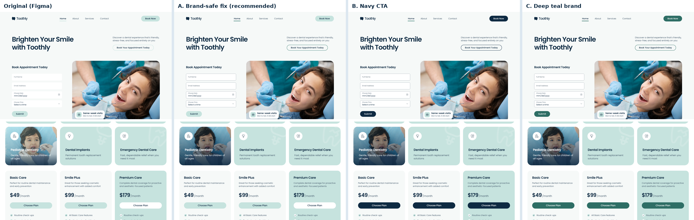

# Toothly, dental clinic website

Static, responsive, animated build of the **Toothly - Dental Clinic Website UI** Figma template
(5 pages: Home, About, Services, Service Details, Contact). No framework, no dependencies.

## Run locally

```bash
python3 -m http.server 8080
```
Open http://localhost:8080.

## Edit pages

Root `*.html` files are generated. Edit `src/pages/*.html` or `src/partials/*.html`, then rebuild:

```bash
python3 tools/build.py
```

## Palette decision (pending)

A temporary **Palette preview** control (bottom-left) switches between four palettes live.
You can also link directly: `index.html?palette=original|a|b|c`. Default is **A**.



| Token / issue | Original | A. Brand-safe fix | B. Navy CTA | C. Deep teal |
|---|---|---|---|---|
| Grey Light text on Grey Subtle | #697884, 4.29:1 (fails AA) | #5F6E7A, 4.96:1 | same as A | same as A |
| Form field edge on page bg | none / #DCE7F0, 1.06 to 1.26:1 | #7D8D99, 3.23 to 3.42:1 | same as A | same as A |
| Active nav, step bar, outline button, icons | Mint #C6E3DE, 1.28:1 | Teal #3A7D73, 4.55:1 | same as A | #2E6E65, 5.6:1 |
| White text on doctor / pediatric photos | 1.9 to 2.9:1 (fails) | 4.6 to 7.5:1 | same as A | same as A |
| Primary button | Mint + navy text, 10.8:1 | unchanged | Navy + white, 14.7:1 | Teal + white, 5.9:1 |

After the final choice: delete `src/partials/palette.html`, its `{{> palette}}` include, the
`.palette` CSS block and the palette section in `js/main.js`, and fold the chosen overrides into `:root`.

## Accessibility work (independent of palette)

- Visible floating labels on every field (the Figma used placeholder-only labels)
- Inline, specific error messages with `aria-invalid`, focus moved to first error, live status region
- Booking rules: no past dates, Sunday closed, Saturday slots end 2:30 PM
- Skip link, landmarks, one `h1` per page, logical heading order
- Visible 3px focus ring everywhere; `forced-colors` support
- FAQ, How It Works, mobile menu: real buttons with `aria-expanded`
- Testimonial and doctor carousels: labelled buttons, off-screen cards made `inert`
- Star ratings exposed as "Rated 5 out of 5"; icon-only social links labelled
- Video opens a native `<dialog>` (Escape closes, focus returns)
- All motion disabled under `prefers-reduced-motion`
- Touch targets 44px or more
- Images: WebP, cropped to their Figma framing, lazy-loaded (76 MB down to 1.2 MB)

Audit: axe-core 4.10 (WCAG 2.2 AA + best practice) on all 5 pages, 0 violations in A, B and C;
12 contrast violations with the original palette.

## Not included

- No backend. Forms validate and show a success state but do not send anything.
- `assets/video/clinic-tour.mp4` is not in the Figma file. The modal shows a notice until it is added.
- Blog posts, Privacy Policy and Terms are placeholder links.
- Content for the non-pediatric service detail views was written for this build (the Figma has only Pediatric).
